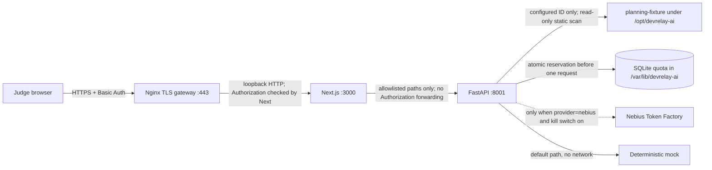

# Phase 8B deployment and judge guide

## Recommendation

Use **Option A, one Linux VM**, after the host/account and organizer requirements are approved. It best fits the existing same-origin Next.js proxy, loopback-only FastAPI, local synthetic fixture, and durable single-host SQLite quota. Use **Option C, a reproducible local test build in mock mode**, as the fallback. Option B (managed/serverless hosting) is not a small fit: the scanner needs an authorized local fixture, the request counter needs durable atomic storage, and the existing frontend proxy expects a loopback backend. Do not deploy this branch until the changes have been reviewed, committed, pushed to the public repository, and a host is explicitly selected.

| Option | Complexity | Security | Judge effort / reliability to Dec 15 | Cost planning | Fit |
|---|---|---|---|---|---|
| A. Single Linux VM | Moderate: systemd, Nginx, TLS, firewall, secret files | Strongest of these options when loopback binds, TLS, shared-password gate, CSRF Origin check, synthetic-only mapping, and quota are configured; still a shared prototype login and non-durable reviews | One HTTPS URL and one shared judge password; one host is easy to explain but needs patching/monitoring through Dec 15 | Example 4 GiB / 2 vCPU DigitalOcean Basic Droplet is listed at $24/month; 52 days from Oct 24 through Dec 15 is roughly $41.60 before taxes, domain, optional backups, or price changes. This is an example, not a selected provider or quote. | Best match after operator and organizer approval |
| B. Managed/serverless | High for this architecture: would need durable storage, filesystem fixture packaging, and cross-service private networking changes | Managed identity could be stronger, but direct Nebius credential custody, filesystem scope, and quota consistency still need design | Potentially low judge setup; reliability depends on platform limits and durable storage | Provider-specific and usage-dependent; no defensible estimate without choosing a service | Not recommended for this phase |
| C. Local test build | Low: documented Python/Node setup; mock provider | No public attack surface if loopback-bound; real inference remains operator controlled | Judges install prerequisites and run locally; least reliable for nontechnical judges and not a public hosted URL by itself | No hosting fee; operator's hardware and any explicitly invoked inference remain separate | Fallback; confirm whether organizers accept this instead of a working public demo URL |

The VM price reference is the provider's published Basic Droplet table and changes over time: [DigitalOcean Droplet pricing](https://www.digitalocean.com/pricing/droplets). Real model inference costs are separate from VM hosting. The persistent count limits request quantity, not dollars; Nebius account billing controls remain necessary. No live request was made to estimate cost.

## Request and trust boundaries



Nginx is the only public service. Bind Next to `127.0.0.1:3000` and FastAPI to `127.0.0.1:8001`; firewall only SSH from an administrator IP and public TCP 80/443. Next's `src/proxy.ts` challenges all app/API paths except static framework assets, and the API catch-all repeats authentication. Mutation requests also require exact `Origin: DEMO_AUTH_ORIGIN`. The credential is not forwarded to FastAPI. The backend remains private by network binding and firewall; do not change either bind to `0.0.0.0`.

The Basic Auth account is one shared, unverified judge login, not per-person identity or role authorization. Use a strong unique username/password, distribute them privately, enable HTTPS before sharing, rotate/revoke access after the judge period, and do not put the values into Devpost, README, browser bundles, recordings, or source files. Environment misconfiguration fails closed with 503; unauthorized requests receive a sanitized 401. Static Next assets are excluded from the auth gate because they contain no secrets; app routes and API/proxy routes remain gated.

## Inference controls

Mock remains the application default and makes no external call. Live inference requires all of: `INFERENCE_PROVIDER=nebius`, `NEBIUS_LIVE_INFERENCE_ENABLED=true`, valid backend-only `NEBIUS_API_KEY`, a positive durable quota, available quota, and a bounded request accepted by existing token/concurrency limits. Set `NEBIUS_LIVE_INFERENCE_ENABLED=false` to stop future outbound calls immediately (restart the process after changing the environment). The dashboard reports provider, kill-switch state, whether a credential is configured (boolean only), and remaining request allowance; it never returns the key. No retry or provider fallback is added.

The SQLite counter stores total and reserved request count under `/var/lib/devrelay-ai`. It atomically reserves before an outbound call and never refunds after an error because the provider might have received/billed the request. It survives restarts, is shared safely by processes, and fails closed if unavailable. Increasing or reducing unused allowance is an operator CLI action; reducing below already-reserved count is rejected. There is no reset command. The initial env total is used only when the database is first created. Keep one backend worker to retain the existing in-process semaphore limit of one; SQLite still guards quota if multiple processes are accidentally started. Neither count quota nor token ceilings is a monetary cap.

Set allowance and view it locally as the service account:

```bash
cd /opt/devrelay-ai
sudo -u devrelay-backend env NEBIUS_QUOTA_DB_PATH=/var/lib/devrelay-ai/nebius-quota.sqlite3 /opt/devrelay-ai/.venv/bin/python -m scripts.inference_quota_admin show
sudo -u devrelay-backend env NEBIUS_QUOTA_DB_PATH=/var/lib/devrelay-ai/nebius-quota.sqlite3 /opt/devrelay-ai/.venv/bin/python -m scripts.inference_quota_admin set-total 10
```

Use the repository virtual environment's Python path in production (for example `/opt/devrelay-ai/.venv/bin/python`) in place of `python`. Choose an allowance after reviewing provider billing; `10` is an example only.

## Novice deployment outline (not executed)

This is a template for a future selected Ubuntu 24.04 host, not a claim that a host exists. Exact prices, region, DNS, TLS provider, and organizational approval remain open.

From Windows PowerShell, connect to the approved host with the SSH user and address supplied by the selected provider (do not put passwords or API keys on this command line):

```powershell
$sshTarget = 'deploy@<approved-server-address>'
ssh $sshTarget
```

Run the Linux setup below in that SSH session. Use the provider's console or an approved interactive editor for protected environment files; do not paste secret assignments into PowerShell history. When the reviewed Phase 8B checkpoint has been published, the Linux host should clone that exact commit/tag rather than copying an unreviewed working tree.

1. **Review and publish the checkpoint first.** Only deploy a reviewed commit that is pushed to the public repository. This working copy contains uncommitted Phase 8B changes, so it is not deployable as-is.
2. **Create the VM and DNS only after approval.** Select a provider and region, assign a stable public IP, point a domain's A/AAAA record to it, allow SSH only from the administrator IP, and allow inbound 80/443. Do not expose ports 3000 or 8001. Do not assume the hackathon reimburses hosting.
3. **Install server prerequisites.** Follow the chosen distribution's official instructions for Python 3.12, Node.js 24, npm, Git, Nginx, and Certbot. Create separate non-login `devrelay-backend` and `devrelay-frontend` service accounts and `/opt/devrelay-ai` owned by a deployment administrator; keep application files read-only to both accounts. Separate UIDs prevent a frontend process from reading the backend process environment, which contains the Nebius credential.
4. **Deploy the reviewed source.** Clone the reviewed branch/tag to `/opt/devrelay-ai`, create `.venv`, install the project's pinned/ranged dependencies, run offline tests, build the frontend with `npm ci && npm run build`, and record the deployed commit hash. Keep `.env` and `node_modules` out of Git.
5. **Create protected runtime directories.** Create `/etc/devrelay-ai` owned by root with mode `0700`; create backend/frontend environment files from the examples with mode `0600`. Create `/var/lib/devrelay-ai` owned by `devrelay-backend:devrelay-backend`, mode `0700`. Never put the API key in a frontend env file, build argument, `NEXT_PUBLIC_*` value, image, or repository.
6. **Configure backend.** Use `deploy/env/backend.env.example` as a template. Keep `INFERENCE_PROVIDER=mock` and the kill switch false while validating deployment. Map only `planning-fixture` to `/opt/devrelay-ai/tests/fixtures/planning_repo`; leave local review and runtime validation disabled. Set quota DB path to `/var/lib/devrelay-ai/nebius-quota.sqlite3`.
7. **Configure frontend.** Use `deploy/env/frontend.env.example`; set the exact public origin (for example `https://demo.example.org`) and provision a unique shared Basic Auth username/password of at least 16 characters using a secret manager or interactive secure editor. Never include actual values in shell history or this repository.
8. **Install service and proxy templates.** Copy the two units from `deploy/systemd/` to `/etc/systemd/system/`. Copy `deploy/nginx/devrelay.conf.example` to Nginx configuration and replace the example domain/certificate paths. Obtain TLS only after DNS works, then run `nginx -t` and `systemd-analyze verify` before enabling services. The example configs have not been validated on this Windows host.
9. **Start safely in mock mode.** Enable/restart the backend and frontend systemd units, then Nginx. Verify external HTTPS challenge, same-origin mutation behavior, status shows mock and no request quota, health, authorized fixture selection, and unauthorized repository denial. Verify from outside that ports 3000/8001 refuse direct connections. Inspect firewall and socket listeners; do not rely on UI alone.
10. **Enable live inference only after separate authorization.** Put the backend key into its protected runtime environment without printing it. Select `nebius`, turn on the kill switch, set a small quota using the local admin CLI, restart backend, verify status, and require separate approval for each bounded live inference test. Disable the kill switch immediately after the agreed demo window. Re-check billing in Nebius; the $25 promotional balance, if available, is not a hard cap.
11. **Operate through Dec 15.** Apply security updates, monitor service/host health without recording Authorization headers or prompts, maintain off-host backups of the quota database if persistence is required, test TLS renewal, rotate shared judge access, and schedule host shutdown after the judge window. A VM outage or unpaid account may still interrupt access; no SLA is provided.

## Judge quick start

1. Open the private HTTPS demo URL and use the shared judge credentials provided out-of-band by the team. Do not send the password through a public submission field.
2. Confirm the workspace names `planning-fixture`; that is the only repository exposed, and it is a synthetic calculator fixture.
3. Choose the division-by-zero task scenario and run repository analysis. The scan reads metadata and Python AST only; it does not execute the fixture.
4. Generate a plan. The banner/status identifies `mock` versus `nebius`; only a response labeled `provider=nebius` and `is_mock=false` is genuine live Nemotron output. The live operator must enable it and quota must be available. Mock output is deterministic and clearly labeled.
5. Inspect source citations. Accepted evidence is tied to scanned files/lines; unsupported citations are displayed as unverified and make the plan ineligible for the guarded proposal.
6. Generate the deterministic proposal only when the exact supported plan is eligible. It is a fixed in-memory diff, not a model-written patch. Inspect the diff and risk notes; the original fixture stays unchanged.
7. Inspect the handoff report. It summarizes plan/proposal/review provenance and says runtime validation is `not_run`. Public deployment keeps local review controls disabled; no public judge decision is represented as verified identity.
8. Do not search for an apply or execute button: neither is available. Human approval remains required before any later engineering action.

### Recovery

- **401:** re-enter the privately supplied credentials; ask the operator to rotate/reset them through the protected host environment if necessary.
- **503 gateway not configured:** operator must correct the server-only auth environment and restart Next.js. No credentials are displayed.
- **Backend offline / invalid response:** operator checks systemd health and loopback listeners; judges cannot access internal ports.
- **Inference disabled/quota exhausted:** do not retry repeatedly; operator verifies the status, kill switch, quota and provider billing. Continue with the clearly labeled mock fallback if available.
- **Plan rejected or insufficient context:** inspect the returned sanitized status/evidence, do not claim a successful plan, and continue with the prepared local fallback.
- **Host unavailable:** use the mock local test-build fallback and disclose that it is not a hosted live Nemotron demo.

## Alternatives and open questions

- **Managed hosting:** reconsider only if it supplies private service networking and persistent transactional storage and can package the fixture read-only. A separate managed database may increase cost and requires cross-service auth. No service was selected or tested.
- **Local test build:** use [docs/setup.md](setup.md), keep both services on loopback, and select mock. This is repeatable but alone may not meet a requirement for a public working demo URL; ask organizers.
- Ask organizers whether a shared-password HTTPS judge URL, synthetic-only data, and operator-controlled bounded live inference satisfy free judge access through Dec 15, and whether a non-hosted fallback can satisfy a separate test-build link requirement.

## Validation boundary

Offline frontend and backend tests can validate auth helpers, route gating, quota accounting, kill-switch behavior, and no-network behavior. They cannot prove Nginx TLS, firewall isolation, systemd hardening, actual public-origin enforcement, VM uptime, account billing, or live Nebius behavior. Those require a separately approved host and controlled post-deployment checks. This task does not deploy or call the provider.
